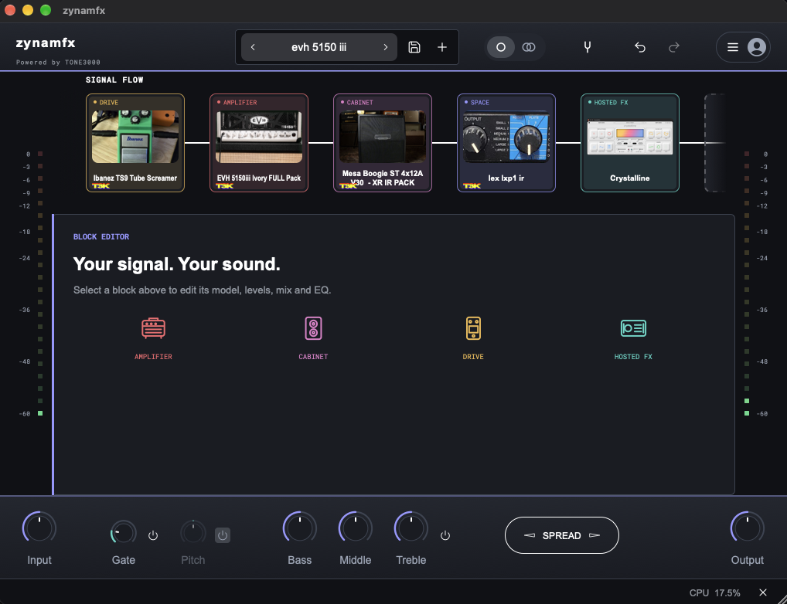

# zynamfx — the free, open-source macOS guitar signal chain

<p align="center">
  
</p>

<p align="center">
  <a href="https://github.com/zackyusof/zynamfx/releases/latest"></a>
  <a href="LICENSE"></a>
  
  
  <a href="https://github.com/zackyusof/zynamfx/stargazers"></a>
  
</p>

**zynamfx** is a free, open-source macOS guitar signal-chain application. It ships as a Standalone app and as Audio Unit (AU) and VST3 plug-ins. It loads Neural Amp Modeler (NAM) captures and impulse responses (IRs), and it hosts separately installed AU/VST3 effects — so the delays, reverbs, EQs, and drives you already own can sit right next to your neural captures instead of being locked out of the chain. Whether a boutique chorus sits before the neural preamp or a pristine stereo delay follows the cabinet, it is all one low-latency rig.

> "I mainly built it for my own needs." — zackyusof

**Free and open source, no catch.** Public builds are keyless and carry no paid tier or upsell: bring your own free TONE3000 publishable key for catalog browsing, or work entirely offline with local `.nam`/IR files and third-party effects. The combined app is AGPLv3 with matching source; the TONE3000 code it builds on stays MIT. zynamfx is an independent community project — not an official TONE3000 product, and not endorsed by TONE3000 or Line 6.

**Actively maintained — this is not an abandoned fork.** zynamfx tracks the upstream [TONE3000 plugin](https://github.com/tone-3000/tone3000-plugin). A GitHub Action checks for a new stable TONE3000 release every day; when one lands it merges it, bumps the zynamfx patch version, rebuilds the Standalone, AU and VST3, validates the AU, packages the matching source, and publishes a fresh zynamfx release automatically. Every release names the exact TONE3000 tag and commit it is based on and ships an `UPSTREAM.txt` provenance file (also recorded in [UPSTREAM.md](UPSTREAM.md)). If an upstream change conflicts with a zynamfx-specific file, the workflow stops without publishing until the change is reviewed — so a release is never silently skipped or shipped from an unreviewed base.

[Download](#install) · [Build from source](#build-from-source) · [Releases](https://github.com/zackyusof/zynamfx/releases) · [Documentation](#documentation) · [Version 2 compared with Version 1](#version-2-compared-with-version-1) · [License](#licensing-and-attribution)

## Install

The [latest release](https://github.com/zackyusof/zynamfx/releases/latest) contains the macOS Apple Silicon Standalone app, AU/VST3 plug-ins, and the corresponding source archive. Builds are ad-hoc signed and are not notarized. See the release notes for installation instructions and supported formats.

### Gatekeeper on first launch

The release builds are ad-hoc signed but not notarized, so macOS may warn that it cannot verify the developer. Only use this exception for a copy downloaded from the [official zynamfx releases](https://github.com/zackyusof/zynamfx/releases), and stop if macOS reports that the app contains malware or is damaged.

To open the Standalone app, try opening `zynamfx.app` once. If macOS blocks it with a developer-verification warning, open **System Settings → Privacy & Security**, scroll to **Security**, choose **Open Anyway** beside zynamfx, and confirm. Apple says this option appears for about an hour after the blocked launch; approving the app this way leaves Gatekeeper enabled.

If an audio host specifically refuses to load an installed AU or VST3 bundle because of its quarantine flag, first verify that the bundle came from the official release. Then remove quarantine from only the affected zynamfx bundle and restart the host:

```sh
# Run only the command for the format you installed.
xattr -dr com.apple.quarantine "$HOME/Library/Audio/Plug-Ins/Components/zynamfx.component"
# Or, for VST3:
xattr -dr com.apple.quarantine "$HOME/Library/Audio/Plug-Ins/VST3/zynamfx.vst3"
```

These commands target the specific user-installed bundle; do not use a wildcard or disable Gatekeeper globally. See Apple's instructions for [opening an app by overriding security settings](https://support.apple.com/en-gb/guide/mac-help/mh40617/27/mac/27) and its overview of [Gatekeeper and runtime protection](https://support.apple.com/en-ie/guide/security/sec5599b66df/web).

## Quick start

1. Download the [latest release](https://github.com/zackyusof/zynamfx/releases/latest) and open `zynamfx.app` (see Gatekeeper above).
2. Add blocks to the chain: a NAM amp/capture, an IR cabinet, and — if you want — a hosted AU/VST3 effect in any slot.
3. To browse the TONE3000 catalog, open **Settings → Plugin**, paste your own free TONE3000 **publishable key (client ID)**, then sign in. Never enter a secret key.
4. Pick a tone, shape it with the per-block controls, and save the rig as a preset. Open the AU or VST3 inside a DAW to use the same chain in a project.

## What it does

- **Build guitar rigs:** arrange NAM amp/capture blocks and IR cabinet blocks in a signal chain. Each independent chain starts with seven slots; add, remove, reorder, duplicate, bypass, and save blocks in presets.
- **Load models:** browse and select tones through TONE3000's hosted OAuth experience, or load your own local `.nam` captures and IR `.wav` files. Models are downloaded only after you choose them; creator attribution and model-license information are retained.
- **Shape the sound:** use per-block level, mix, and six-band EQ, plus global input/output, gate, pitch shift, bass/middle/treble, and stereo spread controls. Presets and session state keep the rig ready for the next session.
- **Host installed effects:** add separately installed AU or VST3 effects to the chain. zynamfx lists installed plug-ins without bundling them; opening an effect displays that plug-in's own editor window.
- **Resize the interface:** the editor window and its contents resize freely together.
- **Use it standalone or in a DAW:** the Standalone app manages its own audio device; AU and VST3 run inside compatible macOS hosts.

## What hosting third-party effects unlocks

Adding third-party AU and VST support completely changes what you can do with a neural amp player. It transforms a basic player into a fully professional, self-contained guitar rig. In practice, hosting gives you:

1. **Studio-grade time effects, post-cabinet.** The built-in delays and reverbs in standard amp modelers often sound flat or generic. Hosting third-party plug-ins lets you run premium algorithmic or convolution reverbs — such as Valhalla VintageVerb or Eventide Blackhole — directly after your Neural Amp Modeler (NAM) cabinet impulse response, creating massive, cinematic ambient spaces right inside the standalone app.

2. **Intelligent, dynamic problem solving.** Guitar pickups and high-gain amp models frequently create harsh resonant frequencies or unwanted string squeaks, and standard graphic EQs cannot fix that without destroying the tone. With VST hosting you can load a dynamic equalizer or frequency-dependent expander — like FabFilter Pro-Q 3 or TDR Nova — that notches out those ear-piercing frequencies only when you strike the strings hard, keeping the overall tone warm and natural.

3. **True analogue character before the amp.** Real players often push the front end of a tube amplifier into saturation with a specific overdrive pedal. Instead of relying on digital simulations, you can load accurate analogue component-modeling plug-ins — Analog Obsession's free preamps, or Brainworx console emulations — right before the neural amp slot, adding authentic harmonic distortion, console saturation, and warmth to the digital capture.

4. **Advanced dynamics control.** High-gain metal rhythm needs strict control to keep palm-mutes from clipping, while clean funk needs a fast, snappy attack — and the basic compressors in standard modelers rarely offer enough control. Hosting third-party VSTs lets you reach for legendary studio compressors: an 1176 for aggressive limiting, an LA-2A for smooth clean leveling, or a multiband compressor to tighten up only the muddy low-end frequencies.

## Version 2 compared with Version 1

This is the public **Version 2** line. Version 1 was the earlier tone3000-plugin-effects source line and is now archived privately. Version 2 is the separate **zynamfx** product and public repository. It uses its own app name, icon, plug-in identifiers, configuration/settings folder (`zynamfx`), standalone bundle, graphics, and release artifacts. The TONE3000 NAM/IR processing foundation and required third-party notices remain credited and licensed under their applicable terms. The two versions are related source lines with distinct product identities. **Version 1 follows the aesthetics of the original TONE3000 plug-in; Version 2 has its own design language**, expressed through its distinct interface, graphics, and visual direction.

**Starting chain slots:** Version 1 shows five slots per lane in an empty chain; Version 2 shows seven, adding two starting slots per lane. This is the initial layout, not a maximum: both versions add a trailing slot as blocks are added.

## How it differs from the official TONE3000 plug-in

TONE3000 owns and operates its account, catalog, and hosted tone-selection service. zynamfx supplies its own signal-chain app and interface while preserving TONE3000 attribution wherever its integration is used. Full catalog browsing and tone selection use TONE3000's hosted OAuth Select experience; zynamfx does not mirror the catalog, bundle catalog models, or present TONE3000 services as its own. Its in-app catalog preview is limited to bounded feeds, and the user requests each model they load.

Public builds contain no API key, account token, or downloaded catalog model. Configure your own TONE3000 **publishable key (client ID)** in Settings → Plugin → TONE3000 API key, then sign in with your account. Never enter a secret key. The product and its builds are free, open source, and have no paid product or upsell. The integration is designed for the current non-commercial Free tier and its documented OAuth flows and bounded list endpoints; API access and terms remain controlled by TONE3000. See the [API Terms](https://www.tone3000.com/api/terms), [API guidance](https://www.tone3000.com/api), and [integration review](docs/tone3000-integration-2026-10-12.md).

The interface identifies the integration as **Powered by TONE3000** and links to [tone3000.com](https://www.tone3000.com). zynamfx uses its own wordmark and graphics. It does not use TONE3000's logo or claim affiliation, approval, or endorsement. Any creator content remains subject to its creator-selected license and attribution requirements.

## macOS configuration and data locations

Per-user zynamfx files are stored under `~/Library/Application Support/zynamfx/`:

- `zynamfx.settings` — Standalone audio-device setup and related JUCE host settings.
- `preferences.settings` — machine-wide plug-in defaults, including multi-core processing, the default NAM model size, input calibration, and oversampling. Shared by Standalone, AU, and VST3.
- `ui-preferences.settings` — interface preferences, your optional TONE3000 publishable key, and the remembered TONE3000 sign-in session. Treat this file as private; it contains saved access and refresh tokens. Signing out clears the saved session.
- `Presets/` — presets saved by the user. Factory presets installed for all users are in `/Library/Application Support/zynamfx/Presets/Factory/`.
- `LocalModels/` — copies of local NAM and IR files imported into zynamfx, so rigs can still find them if the original files are moved.

The diagnostic log is `~/Library/Logs/zynamfx/zynamfx.log`. AU and VST3 chain state is saved by the DAW in its project or session; user presets are separate files in `Presets/` and include the active model data needed to reopen them offline.

## Documentation

| Goal | Start here |
| --- | --- |
| See what changed in each release | [CHANGELOG.md](CHANGELOG.md) · [Latest release](https://github.com/zackyusof/zynamfx/releases/latest) |
| Understand the TONE3000 integration | [Integration review](docs/tone3000-integration-2026-10-12.md) · [Hosted effects](docs/hosted-effects.md) |
| See planned hardware effects send/return | [External effects research](docs/hardware-insert-research-2026-10-12.md) |
| Check licensing and corresponding source | [LICENSE-SCOPE.md](LICENSE-SCOPE.md) · [SOURCE.md](SOURCE.md) · [UPSTREAM.md](UPSTREAM.md) |
| Build the app yourself | [Build from source](#build-from-source) |
| Report a bug or request a feature | [Issue chooser](https://github.com/zackyusof/zynamfx/issues/new/choose) |

## Build from source

Requires macOS, Xcode Command Line Tools, CMake, Ninja, and Git.

```sh
git clone --recurse-submodules https://github.com/zackyusof/zynamfx.git
cd zynamfx
python3 script/build-stadium-prototype.py
```

The build produces `zynamfx.app`, `zynamfx.component` (AU), and `zynamfx.vst3`. Add `--install` to place the app in `/Applications` (or `~/Applications` without admin rights) and the plug-ins in the standard user plug-in folders. The build is keyless by default; enter your own publishable key in the app if you want to use the TONE3000 integration.

Future hardware send/return support is documented in the [external effects research note](docs/hardware-insert-research-2026-10-12.md). It is a proposed feature, not part of the current release.

GitHub Actions checks the latest stable release of [tone-3000/tone3000-plugin](https://github.com/tone-3000/tone3000-plugin) daily. When it finds a newer release, it merges that upstream tag, updates the recorded upstream commit, increments the zynamfx patch version, builds all three macOS formats, validates the AU, packages corresponding source, and publishes a zynamfx release. Each release title and notes identify the exact TONE3000 release and commit used as its base, and the downloads include an `UPSTREAM.txt` provenance file. If upstream changes conflict with zynamfx-specific files, the workflow stops without publishing so the changes can be reviewed and resolved.

## Licensing and attribution

The combined zynamfx application is distributed under **GNU AGPLv3**. Original TONE3000 source portions remain under their upstream **MIT** license; NAM, AudioDSPTools, JUCE, fonts, icons, and other components keep their own notices. The release includes a source archive matching the shipped build. See [LICENSE-SCOPE.md](LICENSE-SCOPE.md), [SOURCE.md](SOURCE.md), [COPYING](COPYING), and the component license notices.

TONE3000 is credited as the source of the upstream application and the provider of the catalog service. NeuralAmpModelerCore and AudioDSPTools are credited to their upstream authors. zynamfx is an independent community project; all referenced names and marks belong to their respective owners.

## Star history

[](https://star-history.com/#zackyusof/zynamfx&Date)
